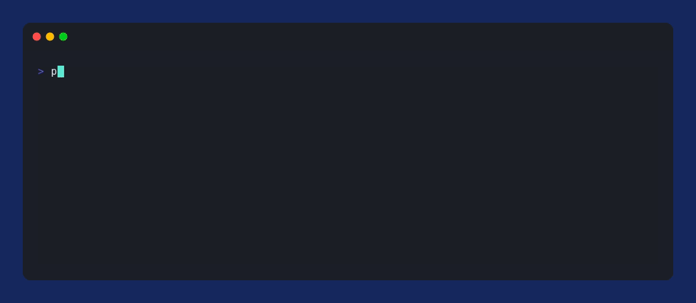
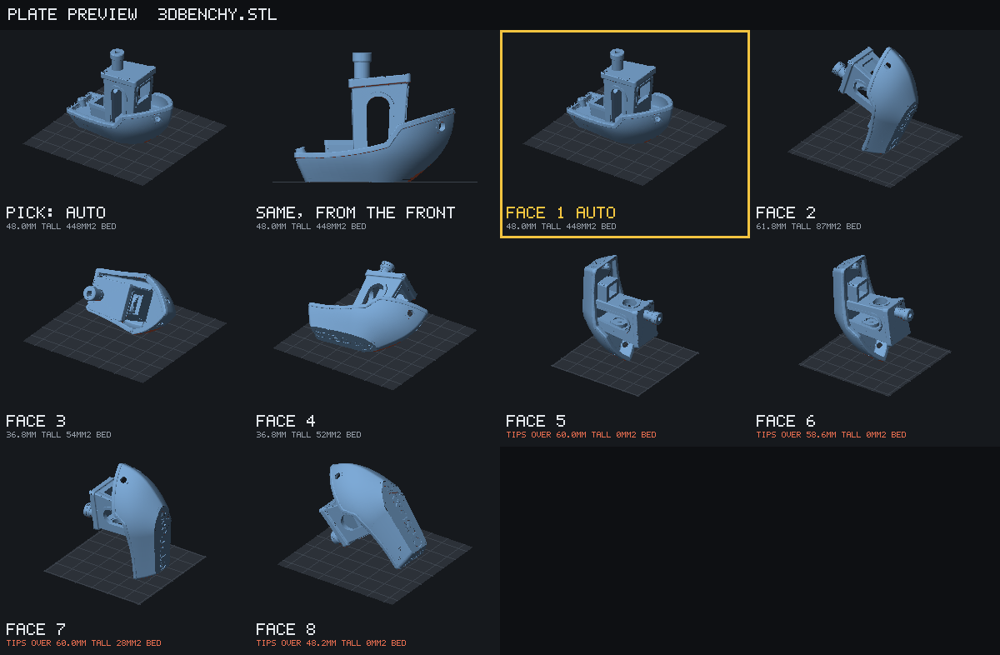

<div align="center">

# platecli

### Print from your terminal — no cloud required

[](https://github.com/DLANSAMA/platecli/actions/workflows/ci.yml)
[](https://pypi.org/project/platecli/)
[](https://pypi.org/project/platecli/)
[](https://pepy.tech/projects/platecli)
[](https://opensource.org/licenses/MIT)
[](#quality)
[](#quality)

[Install](#install) · [Print something](#print-something) · [Try it without a printer](#try-it-in-30-seconds) · [User guide](https://github.com/DLANSAMA/platecli/blob/main/docs/manual.md) · [Troubleshooting](https://github.com/DLANSAMA/platecli/blob/main/docs/troubleshooting.md) · [For scripts and agents](#scripts-and-agents)

</div>

<picture>
  <source media="(prefers-color-scheme: dark)" srcset="https://raw.githubusercontent.com/DLANSAMA/platecli/main/docs/demo-dark.gif">
  <source media="(prefers-color-scheme: light)" srcset="https://raw.githubusercontent.com/DLANSAMA/platecli/main/docs/demo-light.gif">
  
</picture>

Paste a Printables link, get a physical print. `plate` downloads the model, lays it on its best face, slices it with OrcaSlicer, and sends it to your Bambu Lab printer — one guided command, entirely on your local network. No cloud account, no telemetry. Runs on **Linux, macOS, and Windows**, driven by hand or by AI agents.

```text
model URL or file  →  download  →  orient & slice (OrcaSlicer)  →  upload  →  print
                            one command:  plate go
```

**Who it's for**

- **Makers who live in a terminal** — print without opening a slicer GUI or signing in to Bambu's cloud.
- **Homelab and print-farm tinkerers** — every step is a scriptable subcommand with real exit codes.
- **Scripts and AI agents** — `--json` output against [published JSON Schemas](https://github.com/DLANSAMA/platecli/tree/main/docs/schemas/), plus a `--sim` fake printer for building a pipeline with no hardware.
- **Anyone on a locked-down network** — nothing leaves your LAN; no account, no daemon.

**Supported printers:** any Bambu Lab printer with LAN mode — P1P, P1S, X1C, X1E, A1, A1 Mini. Hardware-tested on the **P1 series (P1P/P1S)**; the others speak the same LAN protocols and are expected to work, but are unverified on real hardware, so please [open an issue](https://github.com/DLANSAMA/platecli/issues) with what you hit. `plate snapshot` reads P1/A1-class cameras directly; X1-series cameras need an opt-in local Docker streamer (see the [user guide](https://github.com/DLANSAMA/platecli/blob/main/docs/manual.md)).

## Install

**Requirements:** Python 3.10+, and [OrcaSlicer](https://github.com/OrcaSlicer/OrcaSlicer/releases) installed locally. OrcaSlicer is a **second slicer app, not Bambu Studio**, and `plate` cannot slice without it: `plate go`, `plate job` and `plate slice` run it, while `download`, `status`, `upload` and `print` do not need it. `plate setup` finds the usual install locations for you, and `plate preflight` tells you if it can't. The OrcaSlicer releases slicing is tested with are listed in the [manual](https://github.com/DLANSAMA/platecli/blob/main/docs/manual.md#supported-versions); a release whose profiles `plate` cannot read yet is refused with the newest version that works, rather than sliced with the wrong settings.

```bash
winget install --id SoftFever.OrcaSlicer          # Windows
brew install --cask orcaslicer                    # macOS
```

On Linux, download the AppImage from the [releases page](https://github.com/OrcaSlicer/OrcaSlicer/releases) and extract it; the [manual](https://github.com/DLANSAMA/platecli/blob/main/docs/manual.md#orcaslicer) has the four commands. The Flatpak build is not supported yet.

Then install `plate`:

```bash
pipx install platecli
# or
uv tool install platecli
# or
pip install platecli
```

<sub>Previously published on PyPI as `bambu-local-cli` (yanked). The project is now `platecli`; the installed command is `plate`.</sub>

## Print something

Four steps, no flags to learn:

1. **Install OrcaSlicer** (see [Install](#install)). `plate` runs it to slice; it is a second slicer app, not Bambu Studio.
2. **Turn on LAN mode** on the printer's touchscreen and note the **IP address**, **serial number**, and **LAN access code** shown next to it. The access code is *not* your Bambu account password, and it changes every time LAN mode is toggled or the printer is factory-reset — re-run `plate setup` if it stops connecting.
3. **`plate setup`** asks for those three values and finds OrcaSlicer for you. `plate doctor` then checks the connection end to end (optional).
4. **`plate go`** — paste a model link (or a local file), pick a material and quality, look at the time and filament estimate, and say yes. Plain `plate` in a terminal opens the same wizard.

```bash
plate setup
plate doctor    # optional: verify the connection end to end
plate go        # or: plate go "https://www.printables.com/model/3161-3d-benchy"
```

<picture>
  <source media="(prefers-color-scheme: dark)" srcset="https://raw.githubusercontent.com/DLANSAMA/platecli/main/docs/doctor-dark.gif">
  <source media="(prefers-color-scheme: light)" srcset="https://raw.githubusercontent.com/DLANSAMA/platecli/main/docs/doctor-light.gif">
  
</picture>

The wizard asks for a source, confirms the printer, offers material and quality presets and one supports question, then shows a time and filament preview before the final confirm. If your printer has an AMS, the material step defaults to whatever filament is loaded. Declining the final question offers upload-only, and cancelling keeps the sliced file.

### Without the wizard: `plate job`

`plate go` needs an interactive terminal. Everything it asks maps to a flag on `plate job`, which runs the same `download` → `slice` → `upload` → `print` pipeline in one shot:

```bash
plate job "https://www.printables.com/model/3161-3d-benchy" --confirm
```

`--confirm` is what starts the print. **Without it, `job` / `send` still download, slice, and upload the file to the printer** — they exit `0` with `"status": "uploaded_not_printed"`, and the file sits on the printer unstarted. The commands that act on the printer directly are stricter: `print`, `stop`, `pause`, `resume`, `gcode`, and `delete` refuse without `--confirm` (exit code `5`) and do nothing. (`light` is exempt; an LED is not a physical action.)

## Try it in 30 seconds

No printer yet, or OrcaSlicer not installed yet? Simulation mode fakes a printer so you can look around right away — it needs neither. (A real print still needs both; see [Print something](#print-something).)

```bash
plate --sim status
```

```
🖨️  Bambu Printer Status
   State: IDLE
   Bed: 25°C / 0°C
   Nozzle: 25°C / 0°C
   Fan: 0 | WiFi: -42dBm
   AMS:
     Unit 0 (humidity 5, 26.0°C)
       ▶ Slot 0: PLA #F2F2F2 | 90%
         Slot 1: PETG #0A0AC8 | 60%
         Slot 2: empty
         Slot 3: TPU #000000 | 45%
```

<sub>Timestamps and log-level prefixes trimmed for brevity.</sub>

## Watch the printer

`plate status --monitor` follows a print with a progress bar until it finishes. For a full-screen dashboard, install the optional `[tui]` extra:

```bash
pipx install 'platecli[tui]'    # or: uv tool install 'platecli[tui]' / pip install 'platecli[tui]'
plate tui                       # or: plate tui --sim to explore it without a printer
```

<sub>Install the extra the same way you installed `plate`; a `pip install` into your shell's Python does not reach a `pipx` / `uv tool` environment. Already installed without it? `pipx install --force 'platecli[tui]'` (or `pipx inject platecli textual`).</sub>

`plate tui` shows the job in large type (percent, time left and finish time, layer, feeding tray), the nozzle and bed with their recent history, and the AMS trays (A1–A4 / B1–B4) in each filament's own colour. It can follow a print to completion, and it can start one through the same prepare-and-confirm flow as the wizard, including a terminal preview of the sliced pose and an interactive orientation editor (`o`).

It shares its slicing and job code with `plate go`, so the two cannot drift, and every safety rule holds: a print only starts from the confirm dialog, cancelling keeps the sliced file, and leaving the monitor never stops a print. Textual is never a required dependency, so `plate go` keeps working over SSH, on dumb terminals, and with screen readers.

<p align="center">
  
</p>

## Orient before you slice

`slice`, `job`, `send` and `plate go` lay STL, OBJ, STEP and unsliced 3MF models on their best face automatically (ranked by overhang, height, bed contact and stability) and draw the pose in your terminal before anything is sliced or sent. Pre-sliced 3MFs are never re-oriented. Override with `--orient keep` (as exported), `--face N`, or repeatable `--rotate x=90` / `--rotate z=45`, or inspect a model first with `plate orient` (terminal ranking) and `plate preview` (a PNG of the chosen pose and every ranked face):

```bash
plate download "https://www.printables.com/model/3161-3d-benchy" --output .   # saves 3dbenchy.stl
plate orient 3dbenchy.stl                 # rank faces + draw pose in the terminal
plate preview 3dbenchy.stl                # write 3dbenchy_preview.png
plate slice 3dbenchy.stl --rotate z=45    # slice it turned 45° on the bed
```

<p align="center">
  
</p>

## Scripts and agents

Every command except the two interactive ones emits machine-readable `--json` output backed by published [JSON Schemas](https://github.com/DLANSAMA/platecli/tree/main/docs/schemas/), and `--sim` provides a canned printer (not a protocol test) for development without hardware.

For review-then-run workflows, `job` / `send` emit a SHA-256 `plan_fingerprint` covering the printer, the source, local file bytes, and every slicing and print option. Pass it back with `--expect-plan` and the run refuses to start if anything changed:

```bash
plate job 3dbenchy.stl --dry-run --json                              # review plan_fingerprint
plate job 3dbenchy.stl --json --confirm --expect-plan <fingerprint>  # exits 5 if anything changed
```

`go` and `tui` are for people only: they refuse `--json` and a non-TTY stdin with exit `5`. `plate job <url> --confirm` is the machine path and does the same work.

`--confirm` is a gate against *accidents* (a typo, a truncated argument list, a replayed read-only command), not an authorization boundary: `plate` cannot tell your `--confirm` from an agent's, so sandbox agents accordingly. [AGENTS.md](https://github.com/DLANSAMA/platecli/blob/main/AGENTS.md) has the full agent guide, and [docs/api.md](https://github.com/DLANSAMA/platecli/blob/main/docs/api.md) the JSON contracts and stability policy.

## Security

`plate` talks straight to the printer over your LAN. Printer connections use TLS certificate pinning; model downloads are guarded against SSRF and archive extraction is size-capped; raw G-code and pre-sliced files are checked against heater limits; and printer commands are sent at most once, never silently resent on reconnect. The threat model, reporting channel and known limitations are in [SECURITY.md](https://github.com/DLANSAMA/platecli/blob/main/SECURITY.md).

## Quality

2,947 tests (unit, contract, property-based with Hypothesis, and Textual pilot tests) at 95.0% line and branch coverage, with CI failing the build below 92%. Error-handling lines are not excluded from coverage. CI runs on Linux, macOS and Windows on Python 3.10, 3.12 and 3.14, with `ruff`, `mypy`, `bandit`, `pip-audit`, import-layer and schema-drift checks all blocking, and every run installs the built wheel and sdist and runs the CLI from them. Safety-critical modules also get nightly mutation testing.

## How it compares

The cloud-free Bambu ecosystem is in good shape, and for many people one of these is the better answer:

| Project | What it is | Reach for it when |
|---|---|---|
| [Bambuddy](https://github.com/maziggy/bambuddy) | Self-hosted web command center, from a single printer up to a print farm | You want a dashboard, a print farm, or a full cloud replacement |
| [ha-bambulab](https://github.com/greghesp/ha-bambulab) | The Home Assistant integration: sensors, cameras, automations | Your printer should be part of your smart home |
| [bambulabs_api](https://github.com/BambuTools/bambulabs_api) / [pybambu](https://github.com/greghesp/pybambu) | Python libraries for the printer protocols | You're writing your own application, not running a tool |
| [davglass/bambu-cli](https://github.com/davglass/bambu-cli) | A Node.js CLI (archived; an unrelated project with a similar name) | You live in Node and don't need an actively maintained tool |
| **platecli** | A Python CLI for the whole pipeline | You want one command from a model link to a finished print, scriptable and cloud-free |

## Documentation

- **[User guide](https://github.com/DLANSAMA/platecli/blob/main/docs/manual.md)** — setup, config reference, slicing and AMS mapping, print monitoring, and every flag
- **[Troubleshooting](https://github.com/DLANSAMA/platecli/blob/main/docs/troubleshooting.md)** — keyed by the error message you actually saw
- [AGENTS.md](https://github.com/DLANSAMA/platecli/blob/main/AGENTS.md) — architecture and safety notes for agents and automation
- [docs/api.md](https://github.com/DLANSAMA/platecli/blob/main/docs/api.md) — JSON contracts, support matrix, and stability policy
- [docs/schemas/](https://github.com/DLANSAMA/platecli/tree/main/docs/schemas/) — JSON Schema files for every `--json` payload
- [SECURITY.md](https://github.com/DLANSAMA/platecli/blob/main/SECURITY.md) — threat model, reporting, known limitations
- [CHANGELOG.md](https://github.com/DLANSAMA/platecli/blob/main/CHANGELOG.md) — release notes
- [CONTRIBUTING.md](https://github.com/DLANSAMA/platecli/blob/main/CONTRIBUTING.md) — dev setup, tests, releases
- [Discussions](https://github.com/DLANSAMA/platecli/discussions) — questions and show-and-tell

## Before you print unattended

`plate` can start a print with nobody standing at the machine, which is the point and also the risk. An FDM printer is a hot, moving appliance: a failed print can jam, spaghetti, damage the hotend, or in rare cases start a fire. Keep the printer in view of a person or a camera, don't start long jobs overnight or in an empty house, and leave your printer's own firmware safety features on. `plate` uploads a job and starts it; it does not watch for failures and will not stop a print that is going wrong. What the machine does is your responsibility.

## Status and support

**Beta, pre-1.0.** APIs and config keys follow the stability policy in [docs/api.md](https://github.com/DLANSAMA/platecli/blob/main/docs/api.md). The current release is whatever the PyPI badge above shows; `plate --version` reports the copy you have installed.

platecli is built and maintained by **[Dylan Reed](https://github.com/DLANSAMA)** in spare time. Bug reports and pull requests are welcome: [open an issue](https://github.com/DLANSAMA/platecli/issues) with your `plate doctor` output attached. There is no response-time guarantee, and feature requests may be declined to keep the tool small and local-only. Questions go to [Discussions](https://github.com/DLANSAMA/platecli/discussions), security reports to the channel in [SECURITY.md](https://github.com/DLANSAMA/platecli/blob/main/SECURITY.md), and work enquiries to <reedworks.sc@gmail.com>.

> **Disclaimer:** platecli is an unofficial, community-developed tool. It is not affiliated with, endorsed by, or supported by Bambu Lab. "Bambu Lab" and product names are trademarks of their respective owners, used here only to describe compatibility. The printer protocols (MQTT/FTPS) are reverse-engineered; a firmware update may break functionality without warning — run `plate doctor` after printer updates.

## License

MIT © 2026 Dylan Reed. See [LICENSE](https://github.com/DLANSAMA/platecli/blob/main/LICENSE).
